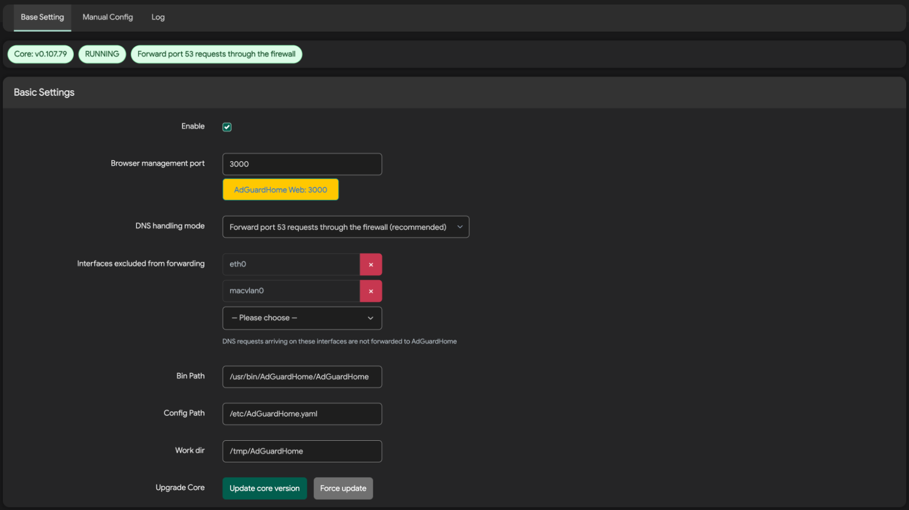
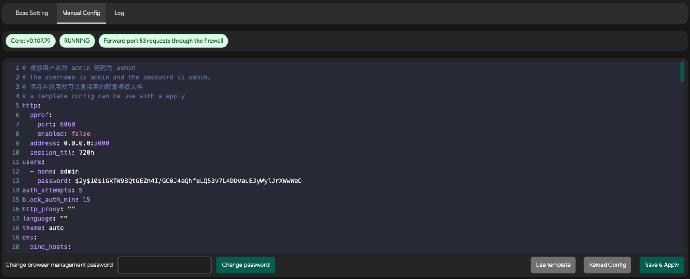
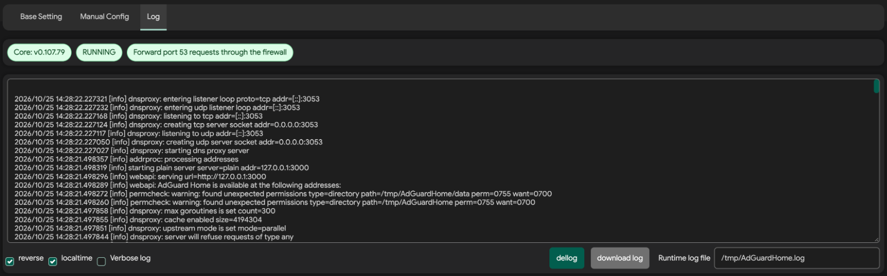

# AdGuard Home for LuCI

Manage AdGuard Home in OpenWrt's LuCI interface. LuCI pages are rewritten in JavaScript, with an rpcd + ucode backend and nftables-based DNS forwarding.

[简体中文](README.md) · [English](README.en.md)

## Features

- Service status and core updates
- DNS handling through firewall forwarding, dnsmasq upstream, or port 53 replacement
- YAML configuration editing, validation, and web login password changes
- Runtime logs with reverse order, local timestamps, download, and a verbose logging toggle

> [!TIP]
> **Quick installation**
>
> Run in the terminal of an OpenWrt router using the APK package manager:
>
> ```sh
> uclient-fetch -O /tmp/install-adguardhome.sh https://raw.githubusercontent.com/w9315273/luci-app-adguardhome/main/scripts/install.sh && sh /tmp/install-adguardhome.sh
> ```

## Screenshots

### Basic settings



### Manual configuration



### Logs


