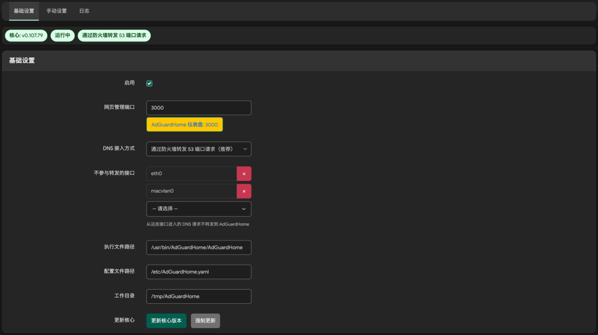
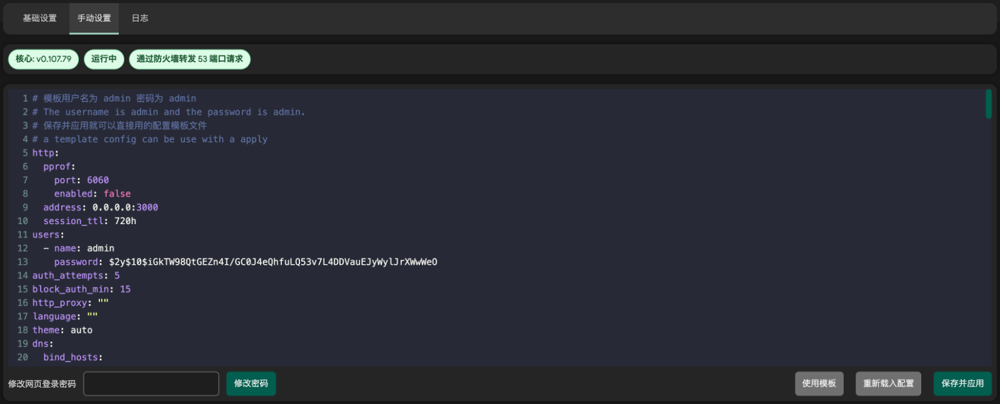
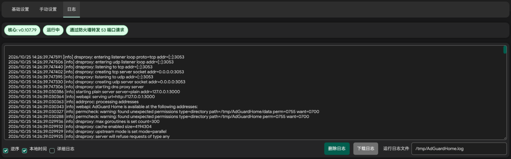

# AdGuard Home for LuCI

在 OpenWrt 的 LuCI 界面中管理 AdGuard Home。使用 JavaScript 重写 LuCI 页面，后端采用 rpcd + ucode，并适配 nftables DNS 转发。

[简体中文](README.md) · [English](README.en.md)

## 功能

- 服务状态查看与核心更新
- 防火墙转发、dnsmasq 上游、替代 dnsmasq 使用 53 端口等 DNS 接入方式
- YAML 配置编辑与校验、网页登录密码修改
- 运行日志查看，支持逆序、本地时间、下载和详细日志开关

> [!TIP]
> **一键安装**
>
> 在使用 APK 包管理器的 OpenWrt 路由器终端执行：
>
> ```sh
> uclient-fetch -O /tmp/install-adguardhome.sh https://raw.githubusercontent.com/w9315273/luci-app-adguardhome/main/install.sh && sh /tmp/install-adguardhome.sh
> ```

## 截图

### 基础设置



### 手动设置



### 日志


